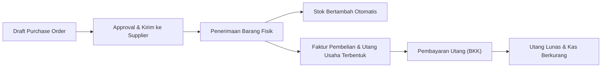
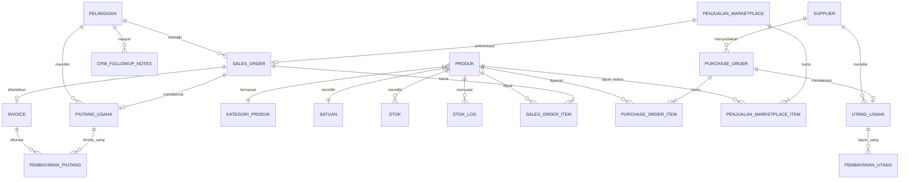

# PRODUCT REQUIREMENTS DOCUMENT (PRD) & SPESIFIKASI ARSITEKTUR
## Sistem ERP, Point of Sale (POS), Omnichannel Marketplace & CRM Metafora
### Versi Platform: CodeIgniter 4 (CI4 Modern Architecture)

---

## 1. Ringkasan Eksekutif & Latar Belakang

### 1.1 Latar Belakang & Visi Produk
Sistem Metafora merupakan solusi terintegrasi Enterprise Resource Planning (ERP), Point of Sale (POS) Kasir Cepat, Integrasi Penjualan Omnichannel Marketplace (Shopee, TikTok Shop, Tokopedia), Manajemen Keuangan (Piutang, Utang, Kas/Bank), Customer Relationship Management (CRM After-Sales WhatsApp), serta Analisis Segmentasi Pelanggan (RFM Analysis).

Migrasi dari CodeIgniter 3 (CI3 HMVC) ke **CodeIgniter 4 (CI4)** bertujuan untuk:
1. **Modernisasi Arsitektur**: Memanfaatkan keunggulan PHP 8.1+, *Strict Typing*, *PSR-4 Namespaces*, *Dependency Injection*, *Entities*, *Model Events*, dan *Command Line Migrations/Seeders*.
2. **Peningkatan Kinerja & Efisiensi**: Struktur CI4 yang ringan dan cepat memberikan performa transaksi POS dan upload massal marketplace yang jauh lebih responsif.
3. **Keamanan Standar Industri**: Proteksi otomatis terhadap CSRF, XSS, Content Security Policy (CSP), Session Hijacking, dan Prepared Statements terisolasi.
4. **Skalabilitas & Pemeliharaan Kode**: Kode modular yang rapi, *Service Layer Pattern* untuk isolasi logika bisnis, dan pengujian (*unit testing*) yang terstandarisasi.

### 1.2 Profil Pengguna (User Personas)
* **Kasir (POS Operator)**: Membutuhkan antarmuka kasir cepat, pencarian barang instan via barcode/nama, diskon langsung, pemilihan metode bayar (Tunai, QRIS, Transfer, Debit), dan cetak struk thermal 58mm/80mm.
* **Admin Stok & Logistik**: Mengelola stok fisik, kartu stok, verifikasi penerimaan barang dari Supplier (PO), packing pesanan marketplace, dan cetak resi thermal.
* **Admin Penjualan & Marketplace**: Mengimpor laporan pesanan Shopee/TikTok/Tokopedia, memindai resi PDF thermal label, dan memonitor status pengiriman.
* **Customer Service & Tim CRM**: Memantau tahapan purnajual (*after-sales*), mengirim pesan konfirmasi pengiriman via WhatsApp Gateway, follow-up H+3 (penerimaan barang), follow-up H+7 (ulasan/repeat order), dan melayani chat pelanggan.
* **Bagian Keuangan (Finance)**: Mengelola penagihan piutang pelanggan, pembayaran utang supplier, pencatatan Bukti Kas Masuk (BKM) & Bukti Kas Keluar (BKK), serta jurnal buku besar.
* **Manajer / Pemilik Bisnis (Owner)**: Mengakses dasbor performa penjualan, melihat peringatan stok menipis, memantau omset riil, dan menganalisis segmentasi pelanggan loyal vs berisiko melalui matriks RFM.

---

## 2. Arsitektur Sistem & Spesifikasi Teknologi CI4

### 2.1 Spesifikasi Teknologi (Tech Stack)
* **Backend Framework**: CodeIgniter 4.4+ (PHP 8.1 / 8.2)
* **Database Engine**: MySQL 8.0+ / MariaDB 10.6+ (InnoDB Engine, utf8mb4)
* **Frontend UI**: Bootstrap 5 + AdminLTE 3 / Tabler Theme + jQuery + Select2 + DataTables
* **PDF Engine**: Dompdf / mPDF (Render A4 invoice, Surat Jalan, dan Label Thermal 100x150mm)
* **Spreadsheet Engine**: `phpoffice/phpspreadsheet` (Ekspor Excel dan Impor Laporan Transaksi CSV/XLSX)
* **WhatsApp Gateway Client**: Integrasi REST API Fonnte / Wablas untuk pengiriman pesan otomatis dan Webhook 2-Way Chat.
* **Web Server**: Nginx / Apache dengan PHP-FPM dan URL Rewriting aktif.

### 2.2 Pola Struktur Direktori CI4 yang Direkomendasikan
Untuk menjaga keteraturan skala enterprise, digunakan pendekatan **Modular Application Architecture**:

```text
ci4_metafora/
├── app/
│   ├── Config/              # Konfigurasi Database, Routes, Filters, App
│   ├── Controllers/         # BaseController & Auth Controllers
│   ├── Database/
│   │   ├── Migrations/      # Skrip Migrasi Skema Tabel Terstruktur
│   │   └── Seeds/           # Seeder Data Master Awal (Role, User, Satuan)
│   ├── Entities/            # Object Model Data (Data Mapping & Formatting)
│   ├── Filters/             # Middleware (AuthFilter, RoleFilter, CorsFilter)
│   ├── Helpers/             # Custom Helper (Format Rupiah, Date, Cleaners)
│   ├── Models/              # CI4 Models dengan Validasi & Callbacks
│   └── Views/               # Shared Layouts (Header, Sidebar, Footer, Modals)
├── modules/                 # Modular Domain Architecture (Setiap modul independen)
│   ├── Auth/
│   ├── Dashboard/
│   ├── Master/              # Produk, Satuan, Kategori, Pelanggan, Supplier, Kurs
│   ├── Stok/                # Manajemen Stok, Kartu Stok, Opname
│   ├── Pembelian/           # Purchase Order, Penerimaan, Utang Usaha
│   ├── PenjualanPOS/        # Kasir Cepat (POS)
│   ├── PenjualanRegular/    # Sales Order, Invoice, Surat Jalan, Piutang Usaha
│   ├── PenjualanMarketplace/# Omnichannel Shopee, TikTok, Tokopedia, Parser Resi
│   ├── Retur/               # Retur Penjualan & Pembelian
│   ├── Keuangan/            # Kas Masuk (BKM), Kas Keluar (BKK), Buku Besar
│   ├── CRM/                 # After-Sales, WhatsApp Gateway, Follow-up, 2-Way Chat
│   └── RFM/                 # Analisis RFM, Strategi Pelanggan, Matriks
├── public/                  # Document Root (index.php, assets, uploads)
└── tests/                   # Automated Unit & Integration Testing
```

---

## 3. Spesifikasi Rinci Modul Fungsional

### Modul 1: Autentikasi, Profil & Role-Based Access Control (RBAC)
* **Autentikasi Aman**: Login berbasis email/username dan password dengan enkripsi `password_hash()` (Argon2ID / Bcrypt), proteksi *brute-force login throttle*, dan *remember-me token* aman.
* **Manajemen Role & Permission**: Hak akses berjenjang (Super Admin, Manager, Kasir, Admin Stok, Staff CS). Setiap aksi (`create`, `read`, `update`, `delete`, `export`) dilindungi oleh CI4 Filters.
* **Audit Trail**: Logging aktivitas perubahan data sensitif (siapa yang mengubah harga, membatalkan pesanan, atau menghapus data).

### Modul 2: Master Data Management
* **Master Produk**: Kode SKU unik, nama produk, kategori, satuan, harga beli pokok (HPP), harga jual standar, harga bertingkat per tier pelanggan (Retail, Grosir, Distributor), batas stok minimum, dan barcode EAN-13.
* **Master Satuan & Kategori**: Hierarki kategori produk dan konversi satuan dasar (Pcs, Box, Pack, Slop).
* **Master Pelanggan**: Kode pelanggan, nama, nomor telepon/WhatsApp, alamat, kota, limit piutang, tempo pembayaran default, dan riwayat belanja.
* **Master Supplier & Kurs Valas**: Manajemen vendor beserta mata uang (USD, SGD, CNY, EUR). Tabel `kurs` menampung nilai konversi terhadap IDR untuk perhitungan HPP impor.

### Modul 3: Manajemen Stok & Inventori
* **Pencatatan Stok Real-Time**: Multi-lokasi / rak penyimpanan, jumlah fisik tersedia, dan stok ter-alokasi (*reserved* untuk pesanan belum kirim).
* **Kartu Stok (Stock Ledger)**: Log mutasi otomatis bertipe *In / Out / Adjustment* mencatat nomor referensi dokumen transaksi, sisa saldo stok, dan operator.
* **Pencegahan Stok Minus**: Sistem memblokir pengeluaran barang jika stok riil tidak mencukupi, kecuali diaktifkan izin khusus otorisasi manajer.
* **Peringatan Stok Minimum (Low Stock Alert)**: Notifikasi visual di dasbor untuk produk yang mencapai batas restock.

### Modul 4: Pengadaan & Pembelian (Purchase Order)
* **Pembuatan PO**: Nomor PO otomatis (`PO-YYYYMM-XXXX`), pemilihan supplier, termin pembayaran (Tunai / Tempo), dan multi-currency (IDR atau Valas dengan kurs otomatis).
* **Penerimaan Barang**: Verifikasi kuantitas pesanan vs kuantitas barang fisik yang sampai. Otomatis menambah stok barang dan mengunci HPP produk.
* **Integrasi Utang Usaha**: Transaksi tempo otomatis membentuk kartu utang usaha pada modul Keuangan dengan tanggal jatuh tempo.
* **Pelunasan Utang**: Pencatatan pembayaran sebagian atau lunas melalui Bukti Kas Keluar (BKK) mengurangi saldo kas/bank yang dipilih.



### Modul 5: Penjualan Kasir Cepat (Point of Sale - POS)
* **Antarmuka Kasir Ergonomis**: Dirancang untuk kecepatan kasir tanpa mouse (*keyboard hotkeys*), pencarian cepat nama produk/barcode, penambahan item instan.
* **Perhitungan Pembayaran**: Diskon item, diskon total belanja (persen/nominal), kalkulasi pajak PPN, hitung otomatis uang diterima dan uang kembalian.
* **Metode Bayar Fleksibel**: Tunai (Cash), QRIS Dinamis/Statis, Transfer Bank (BCA, Mandiri, BRI), Kartu Debit/Kredit.
* **Output Struk**: Cetak struk printer thermal (58mm / 80mm) via JavaScript RAW print atau ESC/POS command.
* **Integrasi Otomatis**: Otomatis mengurangi stok produk, membuat nomor transaksi (`TRX-YYYYMM-XXXX`), membuat invoice berstatus `paid`, dan mencatat Bukti Kas Masuk (BKM).

### Modul 6: Penjualan Regular (Sales Order, Invoice & Piutang)
* **Sales Order (SO)**: Untuk pesanan grosir, B2B, atau transaksi tempo. Mendukung penawaran harga, estimasi pengiriman, dan biaya kirim.
* **Surat Jalan & Pengiriman**: Validasi barang keluar dengan status pengiriman (*draft, packing, ready to ship, shipped, delivered*).
* **Faktur Penjualan (Invoice)**: Cetak faktur formal ukuran A4 (PDF) dilengkapi nomor rekening, syarat pembayaran, dan tanda tangan digital/stempel.
* **Manajemen Piutang Usaha**: Tracking invoice jatuh tempo, status penagihan (*unpaid, partial, paid*), dan pencatatan pembayaran cicilan dengan bukti kas masuk.

### Modul 7: Penjualan Omnichannel Marketplace
* **Multi-Channel**: Mendukung impor data pesanan dari platform Shopee, TikTok Shop, Tokopedia, dan Lazada.
* **Impor Data CSV / Excel**: Parser otomatis file laporan pesanan marketplace. Mampu mencocokkan SKU pesanan dengan master produk, mengekstrak nomor resi, ongkir, voucher platform, dan data pembeli.
* **Ekstraksi Resi PDF Thermal OCR**: Fitur membaca file PDF label pengiriman thermal (100x150mm) untuk membaca barcode resi, kurir ekspedisi (J&T, SPX, JNE, SiCepat), dan nama penerima.
* **Cascade Deletion**: Operasi hapus pesanan membersihkan relasi sub-item, invoice, dan data CRM terkait tanpa meninggalkan data sampah.

### Modul 8: Retur Penjualan & Retur Pembelian
* **Retur Penjualan**: Pengembalian produk rusak/salah kirim dari pelanggan. Pilihan tindak lanjut: ganti barang baru, potong piutang, atau pengembalian dana (refund). Otomatis mencatat barang masuk ke stok fisik/stok rusak.
* **Retur Pembelian**: Pengembalian produk ke supplier. Memotong saldo utang usaha ke supplier terkait atau menerima pengembalian kas.

### Modul 9: Keuangan, Kas/Bank & Buku Besar
* **Manajemen Akun Kas & Bank**: Kas Kasir Tunai, Kas Kasir QRIS, Rekening Bank Operasional, Kas Kecil (Petty Cash).
* **Bukti Kas Masuk (BKM)**: Mencatat seluruh uang masuk dari pelunasan kasir POS, cicilan piutang invoice, atau pendapatan lain-lain.
* **Bukti Kas Keluar (BKK)**: Mencatat pengeluaran operasional, pembayaran utang supplier, beban gaji, listrik, dan biaya operasional.
* **Buku Besar & Jurnal Otomatis**: Sistem menjurnal transaksi penjualan, pembelian, dan kas secara otomatis sesuai bagan akun standar (COA).

### Modul 10: CRM & Layanan Pelanggan (After-Sales Automation)
* **Siklus Follow-up Otomatis**:
  * **H+0**: Konfirmasi pesanan dan nomor resi pengiriman via WhatsApp.
  * **H+3**: Pengecekan barang sampai (*Delivery Experience Confirmation*).
  * **H+7**: Edukasi produk, kepuasan pelanggan, dan penawaran repeat order.
* **WhatsApp Gateway Integration**: Pengiriman template broadcast terpersonalisasi (`{nama}`, `{nomor_resi}`, `{produk}`).
* **2-Way Chat Logging**: Menyimpan riwayat komunikasi dengan pelanggan dan pengelompokan label status CS (*New, Follow-up, Closed, Repeat Order*).

### Modul 11: Analisis Segmentasi RFM (Recency, Frequency, Monetary)
* **Perhitungan Skor RFM**:
  * **Recency (R)**: Jumlah hari sejak transaksi terakhir pelanggan.
  * **Frequency (F)**: Total kali transaksi pelanggan dalam kurun waktu tertentu.
  * **Monetary (M)**: Total perputaran uang/pembelian yang dilakukan pelanggan.
* **Kategori Segmentasi**: *Champions, Loyal Customers, Potential Loyalists, At Risk, Hibernating, Lost*.
* **Strategi Tindakan**: Dashboard CRM menyediakan tombol tindakan langsung untuk mengekspor atau membroadcast promo khusus sesuai segmen (misal: voucher retensi untuk segmen *At Risk*).

### Modul 12: Dasbor Utama & Pelaporan Eksekutif
* **Kartu Ringkasan Real-Time**: Omset Penjualan Hari Ini/Bulan Ini, Total Transaksi, Total Unit Terjual, dan Jumlah Pelanggan Aktif.
* **Grafik Interaktif**: Tren omset 30 hari terakhir, perbandingan omset per channel (POS vs Marketplace vs B2B), dan 10 produk paling laris (*Top Selling Products*).
* **Pusat Unduhan Laporan**: Ekspor laporan penjualan harian/bulanan, laporan mutasi stok, laporan laba kotor, dan rekap keuangan ke format Excel (.xlsx) dan cetak PDF siap arsip.

---

## 4. Desain Basis Data & Diagram Relasi (ERD)



### Spesifikasi Tabel Utama dalam Skema CI4

| Nama Tabel | Fungsi Utama | Kunci Primer | Kolom Kunci / Relasi Penting |
|---|---|---|---|
| `users` | Akun pengguna sistem | `id` (INT Auto) | `username`, `email`, `password_hash`, `role_id`, `status` |
| `produk` | Katalog barang dagang | `id` (INT Auto) | `kode_produk`, `nama_produk`, `kategori_id`, `satuan_id`, `harga_beli`, `harga_jual`, `stok_minimum` |
| `stok` | Saldo stok fisik barang | `id` (INT Auto) | `produk_id`, `qty`, `lokasi_rak`, `updated_at` |
| `stok_log` | Riwayat mutasi inventori | `id` (INT Auto) | `produk_id`, `tipe` (in/out/adj), `qty`, `saldo_akhir`, `referensi_dokumen` |
| `pelanggan` | Master pelanggan offline & online | `id` (INT Auto) | `kode_pelanggan`, `nama_pelanggan`, `no_telp`, `tipe_pelanggan`, `limit_kredit` |
| `supplier` | Master pemasok barang | `id` (INT Auto) | `kode_supplier`, `nama_supplier`, `mata_uang`, `no_telp` |
| `sales_order` | Transaksi POS & Penjualan | `id` (INT Auto) | `nomor_so`, `tanggal_so`, `source` (pos/manual/shopee/tiktok), `pelanggan_id`, `total`, `status` |
| `sales_order_item`| Rincian item pesanan | `id` (INT Auto) | `so_id`, `produk_id`, `qty`, `harga_satuan`, `diskon`, `subtotal` |
| `invoice` | Dokumen penagihan resmi | `id` (INT Auto) | `nomor_invoice`, `so_id`, `pelanggan_id`, `tanggal_invoice`, `total`, `status` (paid/unpaid) |
| `piutang_usaha` | Buku piutang penjualan tempo | `id` (INT Auto) | `nomor_piutang`, `so_id`, `pelanggan_id`, `total`, `sisa`, `status` (lunas/belum) |
| `pembayaran_piutang`| Bukti Kas Masuk (BKM) | `id` (INT Auto) | `nomor_bkm`, `piutang_id`, `pelanggan_id`, `metode_pembayaran`, `akun_kas_bank`, `nominal` |
| `purchase_order` | Dokumen order ke supplier | `id` (INT Auto) | `nomor_po`, `supplier_id`, `tanggal_po`, `mata_uang`, `nilai_kurs`, `total_idr`, `status` |
| `utang_usaha` | Buku utang pembelian tempo | `id` (INT Auto) | `nomor_utang`, `po_id`, `supplier_id`, `total`, `sisa`, `status` |
| `pembayaran_utang` | Bukti Kas Keluar (BKK) | `id` (INT Auto) | `nomor_bkk`, `utang_id`, `supplier_id`, `metode_pembayaran`, `akun_kas_bank`, `nominal` |
| `penjualan_marketplace` | Transaksi pesanan online | `id` (INT Auto) | `no_pesanan`, `source` (shopee/tiktok/tokopedia), `nomor_resi`, `nama_penerima`, `total`, `status` |
| `crm_transaction_followup_labels` | Jadwal follow-up after sales | `id` (INT Auto) | `order_id`, `order_source`, `customer_nama`, `customer_phone`, `label_code`, `target_date`, `status` |

---

## 5. Standar Keamanan & Performa di CodeIgniter 4

1. **Proteksi CSRF (Cross-Site Request Forgery)**
   * Diaktifkan di `app/Config/Security.php` menggunakan mode *Cookie-based Token* atau *Session-based*.
   * Pada request AJAX, header `X-CSRF-TOKEN` wajib dilampirkan otomatis.
2. **Sanitasi XSS & Input Filtering**
   * View rendering wajib menggunakan fungsi bawaan CI4 `esc($data, 'html')`.
   * Model validasi wajib menetapkan aturan ketat: `required|string|max_length[150]`.
3. **Database Transaction Integrity**
   * Setiap proses yang melibatkan lebih dari satu tabel (contoh: Checkout POS -> insert `sales_order`, `sales_order_item`, potong `stok`, catat `stok_log`, insert `invoice`, insert `pembayaran_piutang`) **wajib dibungkus dalam Database Transaction**:
     ```php
     $this->db->transStart();
     // Eksekusi multi tabel
     $this->db->transComplete();
     if ($this->db->transStatus() === false) {
         // Auto rollback
     }
     ```
4. **Optimasi Kueri & Indeks**
   * Penambahan indeks komposit pada kolom pencarian sering: `sales_order (source, status, tanggal_so)`.
   * Pagination dioptimalkan dengan limit & offset terukur, menghindari `SELECT *` yang tidak perlu.

---

## 6. Roadmap Migrasi Bertahap (Sprint Implementation Plan)

### Sprint 1: Setup Lingkungan, Skema Database & Autentikasi (Minggu 1)
* Instalasi CodeIgniter 4 via Composer, konfigurasi `.env`, dan database MySQL.
* Pembuatan skrip `Migration` untuk seluruh skema tabel di atas dan `Seeder` akun awal.
* Pembangunan modul Autentikasi, Middleware/Filters RBAC, dan Template Layout Dashboard Admin.

### Sprint 2: Master Data & Manajemen Stok (Minggu 2)
* Pembuatan CRUD Master Produk, Satuan, Kategori, Pelanggan, Supplier, dan Kurs Valas.
* Pembuatan modul Stok Fisik, mekanisme potong/tambah stok otomatis, dan tampilan Kartu Stok.
* Fitur Peringatan Stok Minimum (*Low stock alert badge*).

### Sprint 3: Pengadaan & Pembelian (Purchase Order) (Minggu 3)
* Pembuatan modul Purchase Order dengan dukungan Valas otomatis.
* Alur Penerimaan Barang yang otomatis memutasi stok masuk dan memperbarui HPP.
* Pembentukan kartu Utang Usaha dan modul pembayaran cicilan / Bukti Kas Keluar (BKK).

### Sprint 4: Penjualan Kasir Cepat (POS) & Penjualan Regular (Minggu 4)
* Pembangunan halaman POS Kasir Cepat ramah keyboard (*fast checkout*).
* Integrasi cetak struk thermal 58mm/80mm dan integrasi pencatatan Bukti Kas Masuk (BKM).
* Pembangunan modul Sales Order (SO), cetak Invoice A4 (PDF), Surat Jalan, dan Piutang Usaha.

### Sprint 5: Omnichannel Marketplace & Ekstraksi Resi (Minggu 5)
* Modul Impor Laporan Excel/CSV Shopee, TikTok Shop, Tokopedia dengan pencocokan SKU produk.
* Modul Parser PDF Resi Thermal Label untuk ekstraksi otomatis nomor resi dan kurir pengiriman.
* Fitur sinkronisasi pesanan marketplace ke Sales Order dan penghapusan *cascade*.

### Sprint 6: Keuangan, Retur, CRM & Analisis RFM (Minggu 6)
* Modul Buku Besar Kas/Bank, Retur Penjualan, dan Retur Pembelian.
* Modul CRM After-Sales (Follow-up H+3 & H+7, WhatsApp Gateway API Fonnte, Log Chat).
* Modul Segmentasi Pelanggan RFM (Kalkulasi skor otomatis dan dasbor grafik loyalitas).
* Pengujian menyeluruh (*System Integration Testing*), audit keamanan, dan *deployment*.
